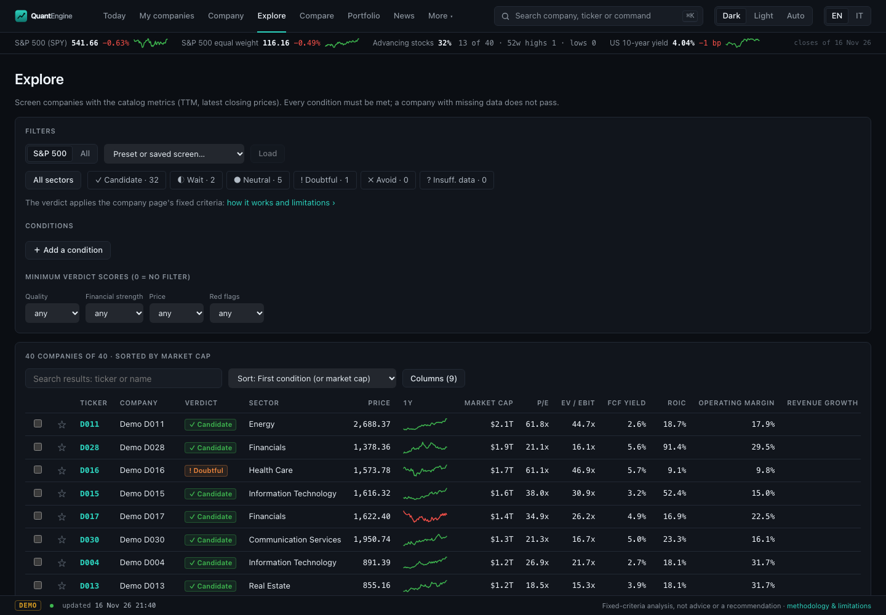
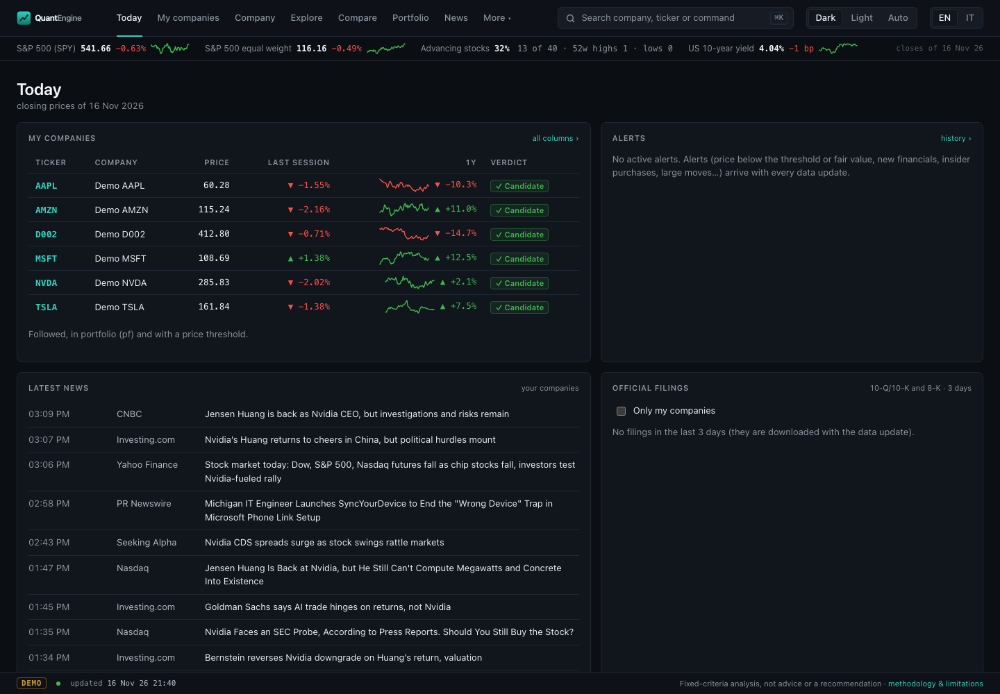
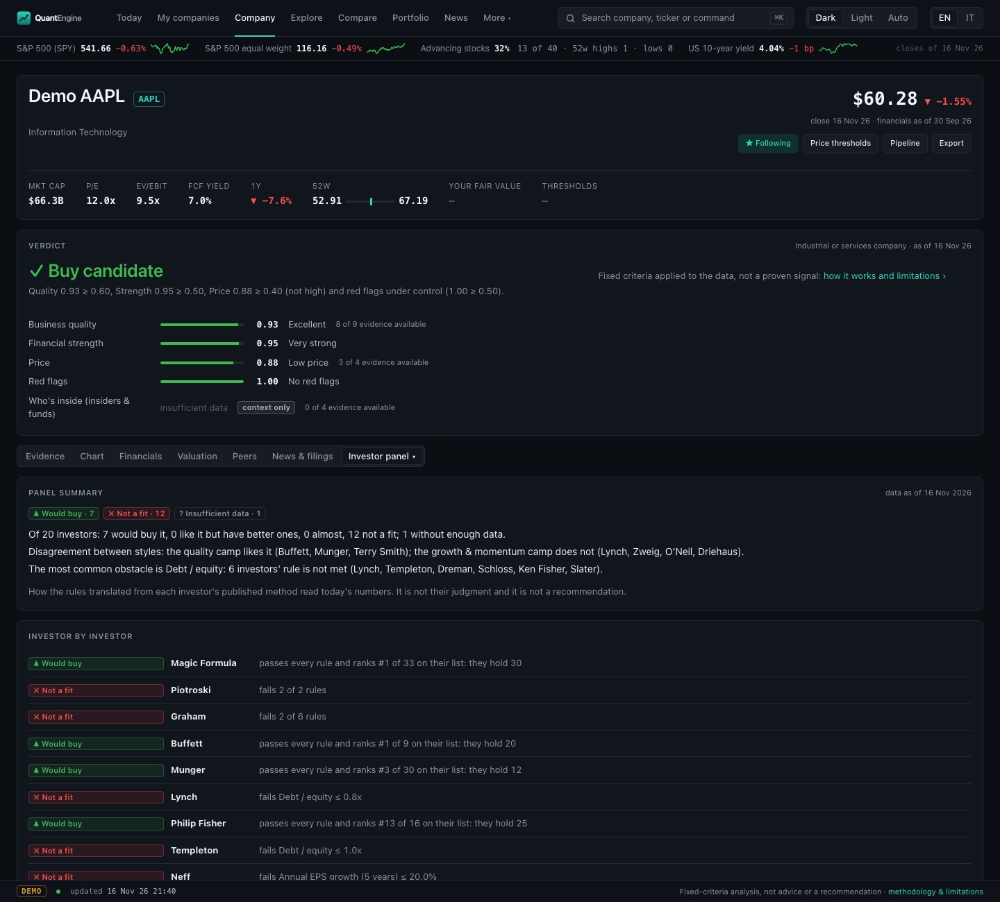

<div align="center">

# 🏛️ QUANT_ENGINE

**A deterministic equity-research engine for the S&P 500: regime detection, intrinsic valuation, multi-factor scoring and point-in-time backtesting.**

No generative AI in the decision loop: only quantitative finance, SEC filings and reproducible rules.


</div>



> ⚠️ Educational / research project. It produces **simulated** orders only and is not connected to any broker. Nothing here is investment advice.

## Why

Most retail "stock pickers" mix look-ahead bias, survivorship bias and hand-tuned magic numbers. QUANT_ENGINE was built to answer one question honestly: *does a rule-based value + quality + momentum process actually beat the index when tested only with the data that was available at the time?*

## What it does

| Layer | Details |
|---|---|
| **Data lake** | Incremental SQLite store of prices (Yahoo), XBRL fundamentals from **SEC EDGAR** (10-K / 10-Q companyfacts), insider trades (Form 4), 13F holdings of 20+ superinvestors, index membership history. Versioned schema with non-destructive migrations. |
| **Market regime** | Hidden Markov Model on SPY → Bull / Neutral / Bear, driving dynamic confidence thresholds. |
| **Valuation** | 10-year DCF with estimated beta, WACC from the 10Y Treasury, fading growth, **reverse DCF** (growth implied by the price), LBO test and Merton distance-to-default. |
| **Factors** | Momentum 12-1, quality (leverage, margins, ROIC), low volatility; walk-forward factor research with significance tests. |
| **Risk** | Circuit breaker on short history, extreme volatility and anomalous moves; risk-parity / min-variance (Ledoit-Wolf) portfolio construction with position caps. |
| **Backtest** | Same pipeline as live analysis, run date by date with **point-in-time** prices, filings and index constituents; next-day execution, costs, ATR stop-loss / take-profit, benchmark vs SPY. |
| **Research** | Pre-registered signal studies (`--research`, `--factors`): every score is tested for whether it actually predicts forward returns. |
| **Webapp** | Streamlit app (Italian) with a terminal-style dark design (light theme available): daily monitor, screener, company sheet, comparisons, portfolio, decision journal, news, data-quality audit. |
| **New interface** | React + TypeScript front end over a FastAPI layer (`/api/v1`, no business logic in the API: it calls the same services as the Streamlit app); command palette (⌘K: `MSFT FA`, `AAPL MSFT`, `FOLLOW KO`), market strip and sparklines, long backtests in a server-side queue. **English by default, Italian selectable**: engine sentences are translated whole at the API boundary from a template catalog, numbers reformatted per locale; stored data and backtest fingerprints never change. |
| **Investors panel** | How the published rules of 20 legendary investors read a given company today (see below). |
| **Ops** | Step-based update pipeline with dependencies and per-step status, nightly `launchd` scheduler, macOS desktop app (pywebview), Excel model and PDF research export, optional static public site. |



## Legendary investors panel



For any company, the panel asks: *would the rules of Graham, Buffett, Munger, Lynch, Philip Fisher, Templeton, Neff, Dreman, Schloss, Klarman, Zweig, O'Neil, Driehaus, O'Shaughnessy, Ken Fisher, Terry Smith, Slater, Pabrai, Greenblatt (Magic Formula) and Piotroski pick it today?*

- Each investor is the same rule-based strategy used in the backtests (`modules/investors.py`): their published method translated into filters, a ranking and a number of positions, with parameters fixed **before** looking at any result.
- For each investor the engine reports a plain outcome — *would buy*, *likes it, has better*, *almost*, *not a fit*, *outside their scope*, *insufficient data* — rule by rule, using exactly the same selection logic as the strategy engine. Missing data never counts as a passed rule.
- For price rules (P/E, P/B, P/E × P/B, yields, EV multiples…) it computes the **price at which the rule would pass** by recomputing the metric at that price, not by guessing.
- A summary shows where investment styles disagree (quality vs deep value vs growth/momentum), the most common obstacle and the highest price at which one more investor would pass all of their rules.
- **No AI and no language models**: every sentence comes from fixed templates filled with numbers from the metrics catalog. It is information only: it never feeds the app's own verdict, alerts or strategies, and it is not the investors' judgment nor a recommendation.

## Quick start

```bash
git clone https://github.com/GiuseppeSavoia/quant-engine.git && cd quant-engine
python3 -m venv .venv && source .venv/bin/activate
pip install -r requirements.txt

python main.py --demo --backtest        # full run on simulated data, no network needed
streamlit run app.py -- --demo          # webapp on http://localhost:8501
(cd web && npm install && npm run build) && python -m api --demo   # new interface on http://127.0.0.1:8600
python -m pytest                        # 660+ tests, none touch the network
```

For real data set `sec.user_agent` in `config.yaml` (the SEC requires a name and contact email), then:

```bash
python main.py                # update data, analyse, generate simulated orders
python main.py --backtest     # + point-in-time backtest of the same strategy
python main.py --research     # does each score predict future returns?
```

## Architecture

```
main.py            orchestrator: universe → ingestion → MarketData → Strategy → orders/report → backtest
config.yaml        every parameter lives here: no magic numbers in code
data/db_manager.py single access point to the SQLite data lake (versioned schema)
modules/           sec_edgar, regime_detection, valuation_model, multi_factor, confidence_engine,
                   portfolio_optimizer, backtester, research, significance, lbo, insiders, ...
safety/            circuit breaker
modules/services/  shared services used by the Streamlit app and the API
api/               FastAPI layer (/api/v1, 127.0.0.1 only until login exists)
web/               React + TypeScript interface (cd web && npm install && npm run build)
ui/                Streamlit pages and design system (CSS tokens, light/dark themes)
tests/             660+ offline tests (fake sources / DemoSource)
```

The same `strategy.py` pipeline is used by live analysis, backtest and research, so there is no "backtest-only" code path that could drift from production.

## Honest results

The built-in research is designed to *falsify* signals rather than to market them. Several classic signals did **not** show a statistically significant edge on 2013-2026 point-in-time data, and the app says so on screen. See [`docs/`](docs) for the decision log and research notes.

## Documentation

- 🇮🇹 [Full user guide (Italian)](docs/GUIDA.md)
- [Design system review](docs/revisione_grafica.md) · [Decision log](docs/storia_decisioni.md) · [Roadmap](docs/prossimi_passi.md)

The new web interface is in English (Italian selectable with the EN/IT switch); the Streamlit app, logs and reports are in Italian.

---

<sub>Built by <a href="https://github.com/GiuseppeSavoia">Giuseppe Savoia</a>.</sub>
